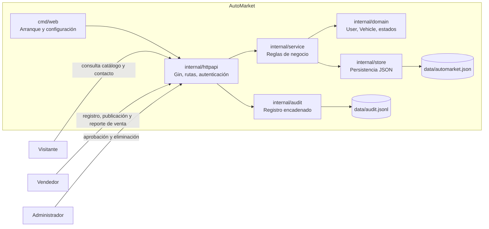
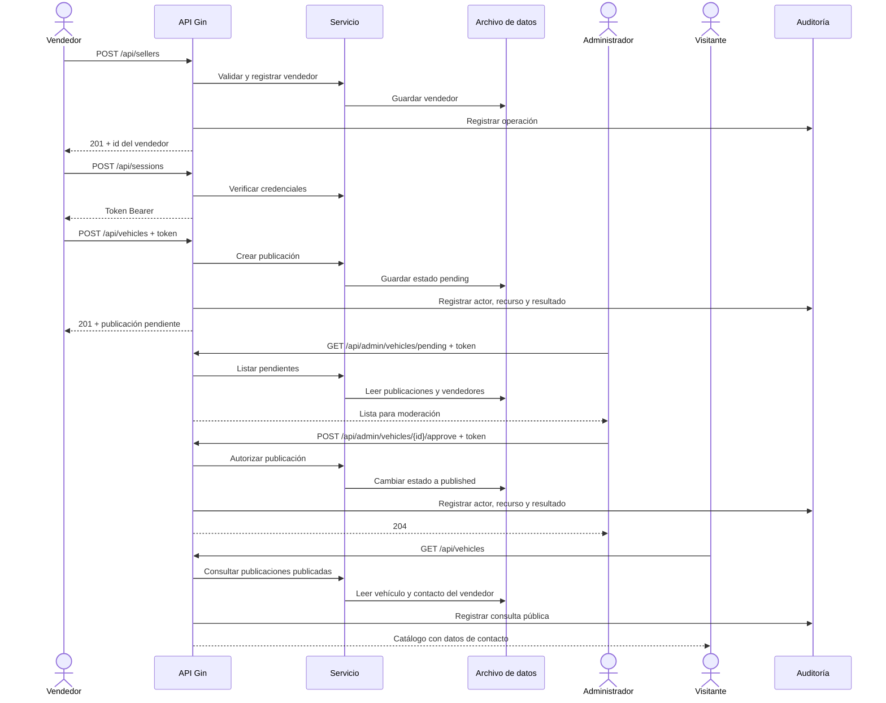

# Diagramas de AutoMarket

Los diagramas están en Mermaid para que GitHub los renderice en este Markdown. Los campos del vehículo reflejan el modelo implementado y deben confirmarse con el equipo antes de cerrar la entrega.

## Estructura

## Comportamiento: publicar, aprobar y consultar

