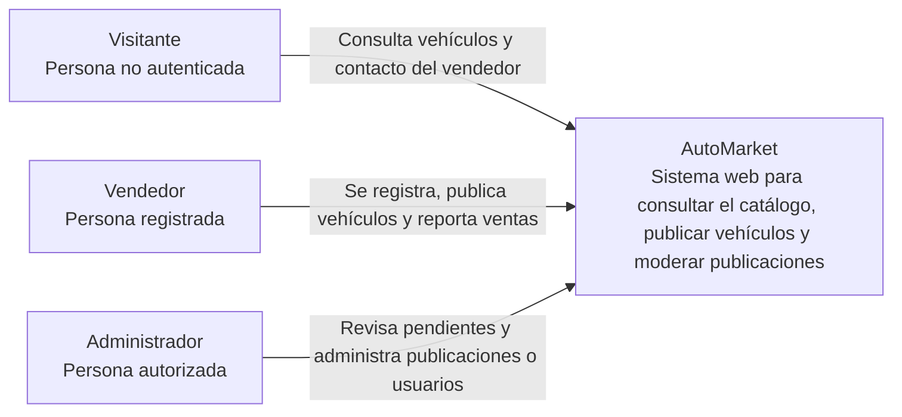
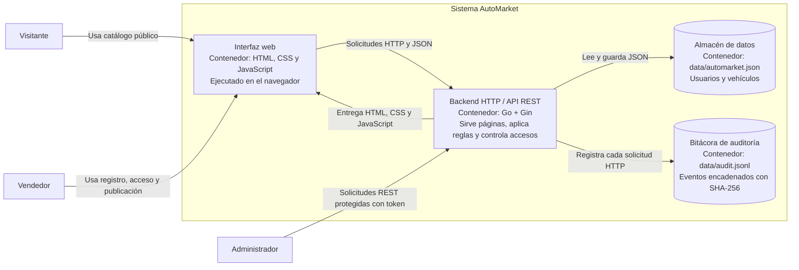
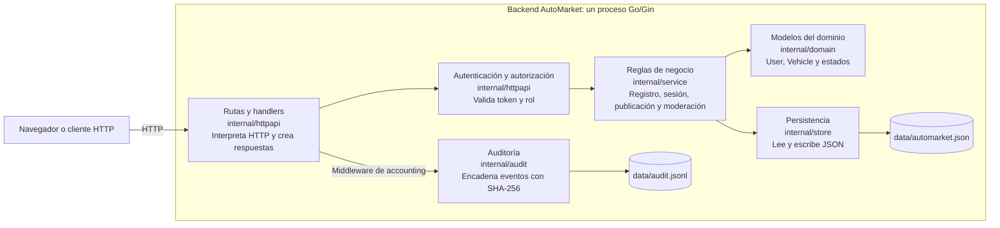
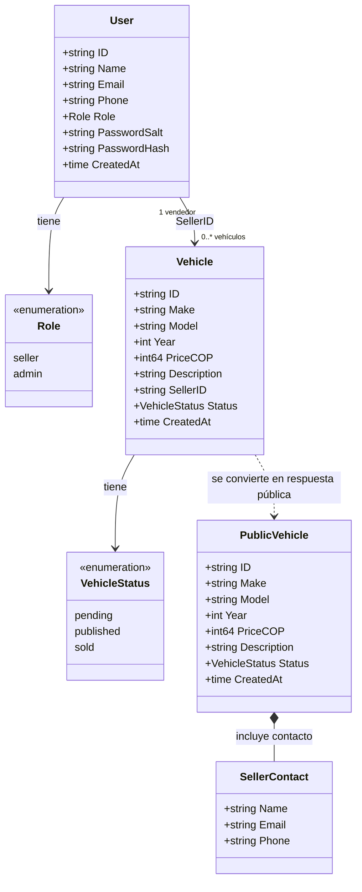
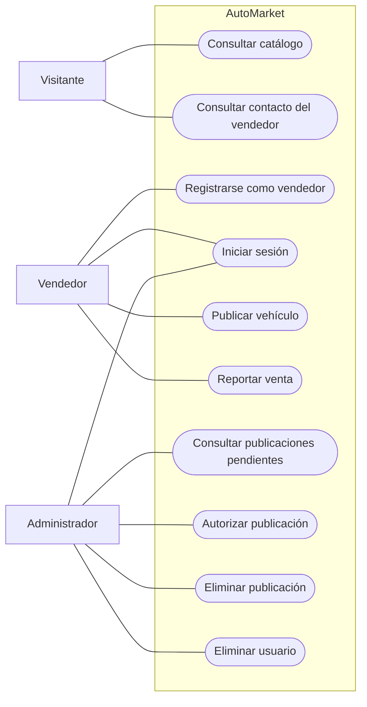
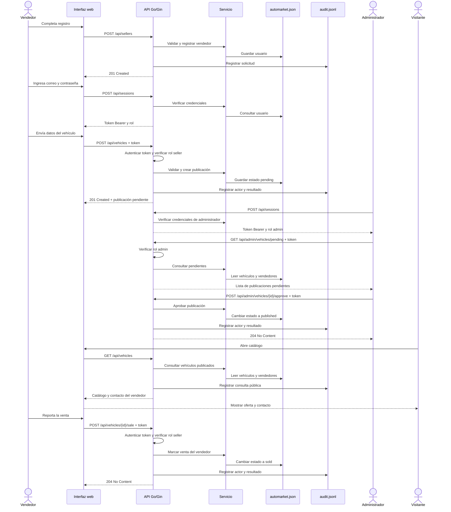

# Diagramas de AutoMarket

Estos diagramas describen el alcance del proyecto de curso y la implementación que existe en el repositorio. GitHub puede renderizar los bloques Mermaid de este archivo.

## 1. Contexto C4

Muestra quién usa AutoMarket y para qué. En este nivel no se muestran paquetes ni archivos internos.

## 2. Contenedores C4: separación estructural

El sistema se separa en interfaz web, backend y dos almacenes persistentes. La interfaz corre en el navegador; el backend Go/Gin sirve las páginas y la API HTTP. Los archivos JSON son almacenes de datos, no componentes de Go.

### Responsabilidades que se separan

- **Interfaz web:** presenta la portada, registro, inicio de sesión y formulario del vendedor.
- **Backend Go/Gin:** contiene las rutas HTTP, autenticación, autorización por rol y reglas de negocio.
- **Almacén JSON:** conserva usuarios, vehículos y sus estados entre reinicios.
- **Bitácora JSONL:** guarda las solicitudes y enlaza eventos para detectar modificaciones.

**Límite actual:** el repositorio no tiene un panel visual de administración. El administrador usa las rutas REST protegidas, por ejemplo con un cliente HTTP. El diagrama no representa una pantalla que todavía no existe.

## 3. Componentes del backend Go

Este diagrama amplía el contenedor del backend. Los paquetes son componentes internos; no son contenedores independientes ni procesos separados.

## 4. Diagrama de clases del dominio

Representa los modelos que aparecen en `internal/domain/models.go`. `PublicVehicle` es la vista pública de un vehículo e incluye los datos de contacto del vendedor.

## 5. Casos de uso

Los casos se limitan a las historias de usuario del curso. No se añaden relaciones `include` o `extend` porque los requisitos no definen esos vínculos obligatorios.

## 6. Secuencia de comportamiento: publicar y aprobar

Flujo principal de las historias de usuario. La aprobación requiere que el administrador se autentique antes de invocar la ruta protegida.

## Diagramas para la entrega

La guía pide un diagrama de estructura y uno de comportamiento en el PDF. Para esa entrega se recomienda usar **Contenedores C4** (sección 2) como estructura y **Secuencia publicar y aprobar** (sección 6) como comportamiento. El diagrama de contexto sirve para explicar el sistema y el resto queda como apoyo para la sustentación.
